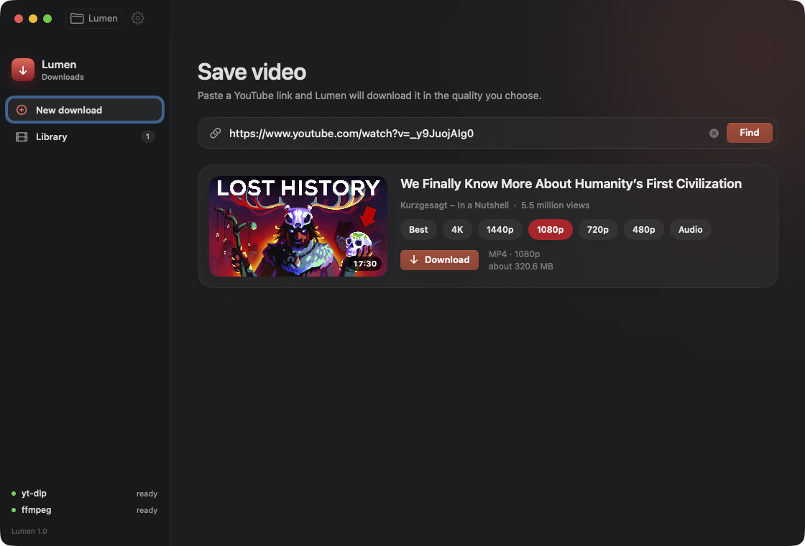
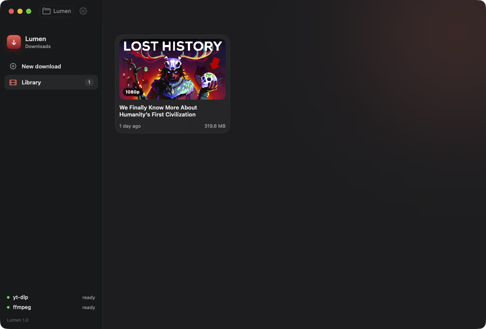
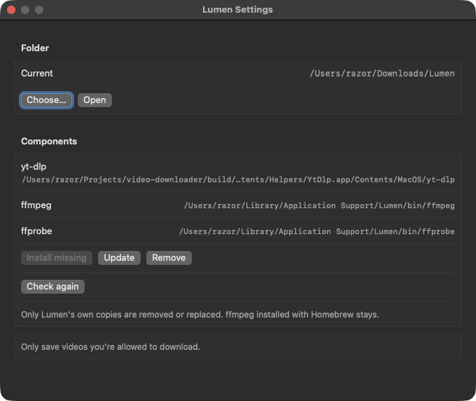

<p align="center">
  
</p>

<h1 align="center">Lumen</h1>

<p align="center">
  A native macOS app for saving YouTube videos.<br>
  Paste a link, pick a quality, and the file lands in a folder on your Mac.
</p>

<p align="center">Follows the system language: English, German, Spanish, French, Japanese, Portuguese, and Russian.</p>

<p align="center">
  
</p>

## Features

- Accepts normal watch links, `youtu.be`, Shorts, live streams, and embeds. A playlist page without a video is ignored.
- Quality choices: Best, 4K, 1440p, 1080p, 720p, 480p, and audio only. Each quality is saved as its own file, so a later download in another quality does not replace the one you already have.
- A queue runs two downloads at a time. The rest wait their turn.
- A library of finished videos, with thumbnails, file size, and the quality on disk. Open a file, reveal it in Finder, or move it to the Trash.
- Files go to `~/Downloads/Lumen` unless you pick another folder from the toolbar or from Settings.
- Drag a link onto the window, or press **⌘R** to look it up and **⌘↩** to start the download.
- Closing the window leaves Lumen in the Dock. Clicking the icon opens the window again.

<p align="center">
  
</p>

## Requirements

- macOS 14 or later
- Swift 6, from Xcode or the Command Line Tools
- A network connection the first time Lumen fetches its download tools

## Build

From the project directory:

```bash
./scripts/build.sh
open build/Lumen.app
```

The script draws the icon, compiles a release build, and assembles an ad-hoc signed `build/Lumen.app`. If yt-dlp is already installed for your user, the script copies it into the app.

Run the tests with:

```bash
swift test
```

## Components

Lumen does not download videos itself. It uses three free tools:

| Tool | Role |
| --- | --- |
| **yt-dlp** | Reads the YouTube page and downloads the streams. |
| **ffmpeg** | Merges separate video and audio into one MP4. 1080p, 1440p, and 4K need it. Without it, YouTube usually offers a single file up to 720p. |
| **ffprobe** | Looks at the finished file so yt-dlp can confirm the streams. Downloads still work if it is missing. |

On first launch, **Install** downloads anything that is missing:

- yt-dlp comes from the [yt-dlp GitHub releases](https://github.com/yt-dlp/yt-dlp/releases).
- ffmpeg and ffprobe come from [evermeet.cx](https://evermeet.cx/ffmpeg/). If Homebrew already provides ffmpeg, Lumen uses that copy and does not download another one.

Lumen keeps its own copies in `~/Library/Application Support/Lumen/bin`. Settings can install what is missing, replace Lumen's copies with fresh ones, or remove them. ffmpeg installed with Homebrew is left alone.

YouTube changes often enough that an old yt-dlp eventually stops working. Update it from Settings when a video that used to download starts failing. ffmpeg rarely needs an update.

<p align="center">
  
</p>

## Firewall prompts

yt-dlp connects to the network on its own. A firewall such as LuLu asks for permission per program, so allowing Lumen is not the same as allowing yt-dlp. When the prompt appears, allow it. If nothing happens and no prompt shows up, add an allow rule for the yt-dlp helper yourself.

## Project layout

```
Sources/Lumen/          SwiftUI interface
Sources/LumenCore/      Link parsing, yt-dlp, and ffmpeg
Resources/              App metadata, icon, English and Russian strings
scripts/build.sh        Release build
Tests/LumenCoreTests/   Engine tests
```

Only save videos you are allowed to download.
